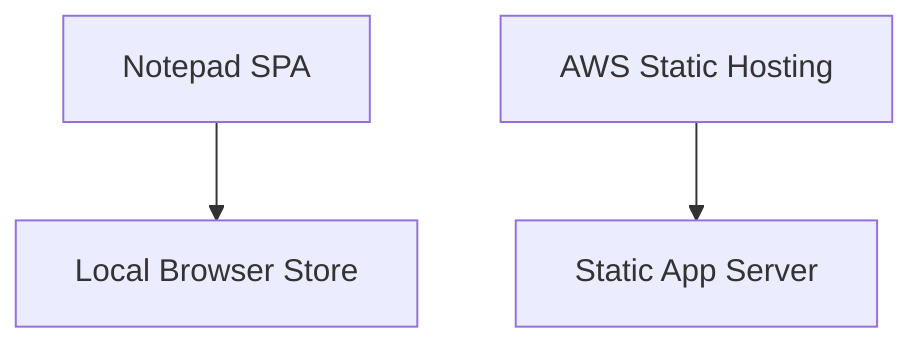
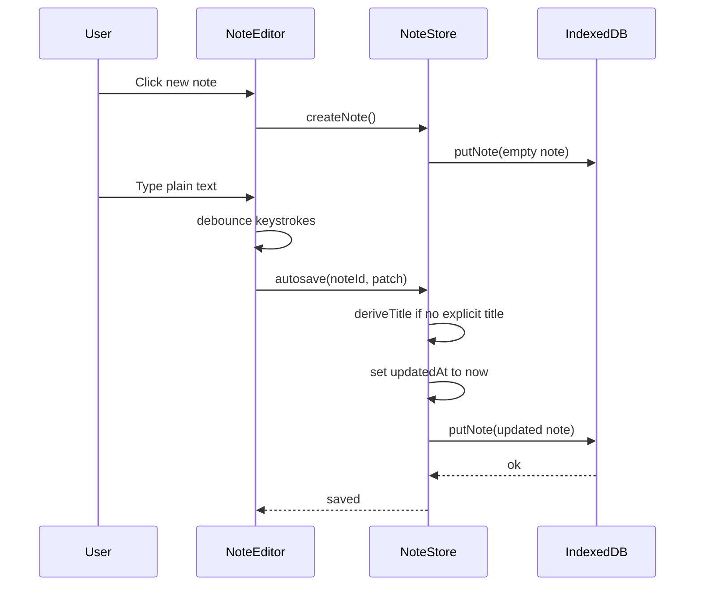
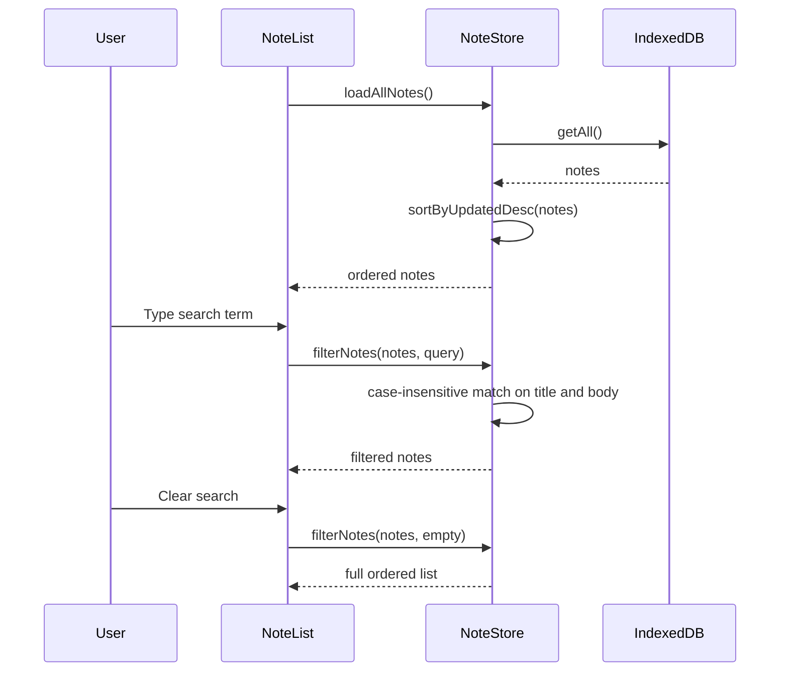
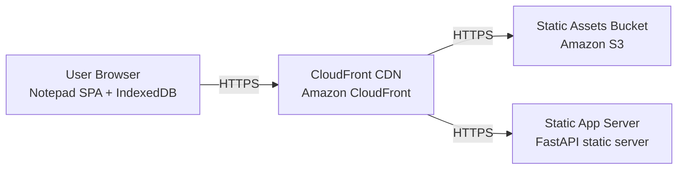

# Architecture

> Maintained by QuorQ AI SDLC. Text between `sdlc:auto` markers is regenerated; anything outside them is yours and is kept.

<!-- sdlc:auto:start narrative -->
## Overview

### ARCH-001 · approved · source: architecture:summary

Simple Note Pad is a client-side-only, single-user plain-text notepad running as a React 19 SPA in the browser.

Approved architecture, version 1. All note operations (create, view, edit, delete, auto-save, title derivation from first line, recency ordering, live case-insensitive search) happen entirely in the browser and persist to the device's own IndexedDB. Nothing is sent to a server; there is no account, login, or payment. The approved FastAPI 0.115 backend only serves the built app's static files on first visit and holds no note logic, staying idle thereafter. AWS hosts the static app. PostgreSQL 16 is named as the approved database choice but stores none of the users' notes -- the browser's own storage is the system of record. Cross-device sync and cloud backup are explicitly out of scope.

**Related:** US-001, US-002, US-003, US-004, US-005, US-006, US-007, US-008, US-009, US-010, US-011, US-012

- ⚠ No explicit mapping was provided linking individual requirements (US-001..US-012) to specific architecture components; the related_ids above reflect that this architecture is intended to cover the full requirement set, not a confirmed per-requirement trace.
- ⚠ No architecture diagram included in input.

### ARCH-COMP-WEBAPP · approved · source: architecture:components.web_app

Notepad SPA (React 19) is the entire product surface: note editor and list, CRUD, title derivation, auto-save, ordering, and live search.

Component: web_app. Renders the note editor and note list. Supports creating, viewing, editing, and deleting notes. Derives a note's title from its first line. Auto-saves on keystroke. Orders the list by most-recently-edited. Filters the list live as the user types. Requires no account or login.

- ⚠ No direct requirement IDs were attached to this component in the input.

### ARCH-COMP-LOCALSTORE · approved · source: architecture:components.local_store

Local Browser Store (IndexedDB) is the single source of truth for all note data; nothing leaves the device.

Component: local_store. Client-side persistence of all notes on the device using the browser's IndexedDB. Satisfies NFR-001 (nothing leaves the device). Accepted risk per NFR-002: clearing browser data, or switching device/browser, loses notes -- this is a known, accepted limitation, not a defect.

**Related:** NFR-001, NFR-002

- ⚠ NFR-001 and NFR-002 are referenced by the architecture input but were not included in the known requirement-keys list for this phase; confirm these NFR ids exist in the requirements set.

### ARCH-COMP-STATICSERVER · approved · source: architecture:components.static_server

Static App Server (FastAPI 0.115) serves the built SPA's static files to the browser on first visit only.

Component: static_server. No note logic, no API beyond serving static files, no persistence. Idle after the app is delivered to the browser.

### ARCH-COMP-HOSTING · approved · source: architecture:components.hosting

AWS Static Hosting delivers the static app over HTTPS; the only cloud hosting this product needs.

Component: hosting. Hosts and delivers the static app over HTTPS so users can open it in a browser.

### ARCH-CRITPATH-001 · approved · source: architecture:critical_paths

Create and auto-save a note: typing updates title/body and persists to IndexedDB automatically, debounced.

User creates an empty note and types plain text. Every change to title or body is written to IndexedDB automatically (debounced). The last-edited timestamp updates, causing the note to rise to the top of the recency-ordered list.

**Related:** web_app, local_store

### ARCH-CRITPATH-002 · approved · source: architecture:critical_paths

Load, order, and live-search notes: notes load ordered by recency and filter live as the user types.

On app open, notes load from IndexedDB ordered by most recently edited. As the user types in the search box, the list filters live and case-insensitively on title and body, with no submit or refresh required. Clearing the search box restores the full ordered list.

**Related:** web_app, local_store

### ARCH-ENTITY-NOTE · approved · source: architecture:entities.note

The note entity has id, title, body, created_at, and updated_at fields.

Entity: note. Fields: id, title, body, created_at, updated_at. Stored client-side in IndexedDB; this is the only data entity in the system.

### ARCH-ENDPOINT-GET · approved · source: architecture:endpoints

GET / serves the built Notepad SPA to the browser on first visit -- the only server interaction in the product.

Endpoint: GET /. Serves HTML/JS/CSS for the built Notepad SPA. This is the sole server-side endpoint in the entire architecture; no other API routes exist.

**Related:** static_server

### ARCH-DEPLOY-001 · approved · source: architecture:deployment_nodes

Deployment topology: CloudFront CDN + S3 static assets bucket in front of a FastAPI static server, delivering the SPA to the user's browser where IndexedDB lives.

Deployment nodes: (1) CloudFront CDN (Amazon CloudFront, AWS managed CDN). (2) Static Assets Bucket (Amazon S3, AWS managed object storage). (3) Static App Server (FastAPI static server, Python 3.12 / Uvicorn, FastAPI 0.115). (4) User Browser (Notepad SPA + IndexedDB, React 19 SPA with IndexedDB storage) -- the runtime environment where all note logic and persistence actually occurs.

**Related:** hosting, static_server, web_app

- ⚠ Input does not specify how S3/CloudFront and the FastAPI static server interact (e.g. whether FastAPI serves from S3 or CloudFront fronts the FastAPI server directly) -- deployment wiring detail is not fully specified.

### ARCH-TECH-FRONTEND · approved · source: architecture:technology_decisions.Frontend

Frontend technology: React 19, chosen over Vue and Svelte.

React 19 implements the entire product: a single-page notepad handling instant editing, auto-save, recency ordering, and live search, and reading/writing the browser's own IndexedDB directly.

**Related:** web_app

### ARCH-TECH-BACKEND · approved · source: architecture:technology_decisions.Backend

Backend technology: FastAPI 0.115, chosen over Flask and Node/Express.

The product has no server-side logic by design. FastAPI 0.115 does only the minimal job of serving the built app's static files on first visit, then stays idle.

**Related:** static_server

### ARCH-TECH-DB · approved · source: architecture:technology_decisions.Database

Database technology: PostgreSQL 16 named as approved choice, with the explicit alternative of none (browser storage only) -- but it stores no note data.

PostgreSQL 16 is named because the architecture process requires a database-layer choice, but it holds none of the users' notes: the browser's IndexedDB is the system of record, since notes never leave the device.

**Related:** local_store

- ⚠ PostgreSQL is listed as an approved technology decision but is not used by any component, critical path, or entity in this architecture -- confirm with the architecture owner whether this is intentional placeholder/future-proofing or should be removed from the stack.

### ARCH-TECH-CLOUD · approved · source: architecture:technology_decisions.Cloud

Cloud technology: AWS, chosen over Netlify and Cloudflare Pages.

AWS hosts the static app reliably and cheaply over HTTPS via S3 and CloudFront -- the only hosting this product needs, with room to grow if backup or sync are reconsidered later.

**Related:** hosting
<!-- sdlc:auto:end narrative -->

<!-- sdlc:auto:start building-blocks -->
## Building Block View

| ID | Name | Technology | Responsibility | Depends on |
|---|---|---|---|---|
| web_app | Notepad SPA | React 19 | The whole product: renders the note editor and list, creates/views/edits/deletes notes, derives titles from first line, auto-saves on keystroke, orders by most-recently-edited, and filters the list live as the user types. Requires no account or login. | local_store |
| local_store | Local Browser Store | Browser IndexedDB | Client-side persistence of all notes on the device using the browser's IndexedDB. The single source of truth for note data; nothing leaves the device (NFR-001). Accepted risk: clearing browser data or switching device/browser loses notes (NFR-002). | — |
| static_server | Static App Server | FastAPI 0.115 | Serves the built SPA's static files to the browser on first visit. No note logic, no API, no persistence; idle after the app is delivered. | — |
| hosting | AWS Static Hosting | AWS | Hosts and delivers the static app over HTTPS so people can open it in a browser. The only cloud hosting this product needs. | static_server |

<!-- sdlc:auto:end building-blocks -->

<!-- sdlc:auto:start runtime -->
## Runtime View

### Create and auto-save a note

User creates an empty note, types plain text, and every change to title or body is written to IndexedDB automatically (debounced), updating the last-edited timestamp so the note rises to the top of the list.

- **Components:** web_app, local_store
- **Modules:** noteEditor, noteStore, titleDeriver, autosave
- **Key functions:** createNote(), deriveTitle(bodyText), autosave(noteId, patch), putNote(note), touchUpdatedAt(note)

### Load, order and live-search notes

On app open, notes load from IndexedDB ordered by most recently edited. As the user types in the search box, the list filters live and case-insensitively on title and body, with no submit or refresh; clearing the box restores the full ordered list.

- **Components:** web_app, local_store
- **Modules:** noteList, noteStore, search
- **Key functions:** loadAllNotes(), sortByUpdatedDesc(notes), filterNotes(notes, query), onSearchChange(query)

<!-- sdlc:auto:end runtime -->

<!-- sdlc:auto:start deployment-view -->
## Deployment View

| Name | Service | Runtime | Scaling | Environment |
|---|---|---|---|---|
| CloudFront CDN | Amazon CloudFront | AWS managed CDN | AWS-managed edge, auto | dev |
| Static Assets Bucket | Amazon S3 | AWS managed object storage | AWS-managed | dev |
| Static App Server | FastAPI static server | Python 3.12 / Uvicorn (FastAPI 0.115) | single small instance, optional — used to serve the app files | dev |
| User Browser | Notepad SPA + IndexedDB | Browser (React 19 SPA, IndexedDB storage) | per-device, client-side | dev |

| Source | Target | Protocol |
|---|---|---|
| User Browser | CloudFront CDN | HTTPS |
| CloudFront CDN | Static Assets Bucket | HTTPS |
| CloudFront CDN | Static App Server | HTTPS |

<!-- sdlc:auto:end deployment-view -->

<!-- sdlc:auto:start decisions -->
## Architecture Decisions

| Layer | Choice | ADR |
|---|---|---|
| Frontend | React 19 | [ADR-0001](adr/frontend.md) |
| Backend | FastAPI 0.115 | [ADR-0002](adr/backend.md) |
| Database | PostgreSQL 16 | [ADR-0003](adr/database.md) |
| Cloud | AWS | [ADR-0004](adr/cloud.md) |
<!-- sdlc:auto:end decisions -->

<!-- sdlc:auto:start links -->
## Related Documents

- [Data Model](data-model.md)
- [API Specification](api/openapi.yaml)
- [Architecture Decision Records](adr/README.md)
<!-- sdlc:auto:end links -->
