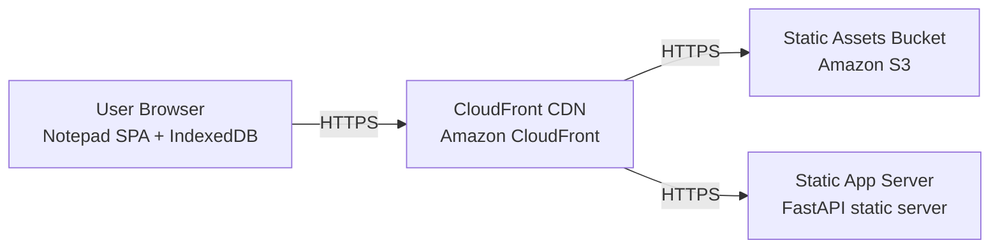

# Deployment Guide

> Maintained by QuorQ AI SDLC. Text between `sdlc:auto` markers is regenerated; anything outside them is yours and is kept.

<!-- sdlc:auto:start how-it-deploys -->
Pushes to `main` run `.github/workflows/deploy.yml`, which builds the API image (if there is a backend) and deploys the SPA to AWS Amplify. Commits touching only `docs/sdlc/**` don't deploy. Deployments can also be started from the platform's Deployment tab.
<!-- sdlc:auto:end how-it-deploys -->

<!-- sdlc:auto:start environments -->
| Name | Service | Runtime | Scaling | Environment |
|---|---|---|---|---|
| CloudFront CDN | Amazon CloudFront | AWS managed CDN | AWS-managed edge, auto | dev |
| Static Assets Bucket | Amazon S3 | AWS managed object storage | AWS-managed | dev |
| Static App Server | FastAPI static server | Python 3.12 / Uvicorn (FastAPI 0.115) | single small instance, optional — used to serve the app files | dev |
| User Browser | Notepad SPA + IndexedDB | Browser (React 19 SPA, IndexedDB storage) | per-device, client-side | dev |
<!-- sdlc:auto:end environments -->

<!-- sdlc:auto:start live -->
_Not deployed yet._
<!-- sdlc:auto:end live -->

<!-- sdlc:auto:start topology -->

<!-- sdlc:auto:end topology -->
